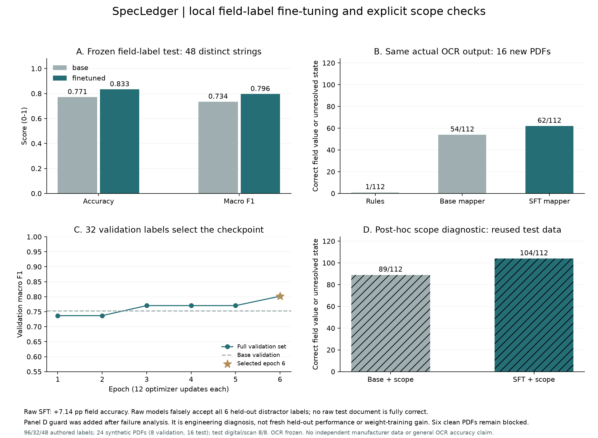
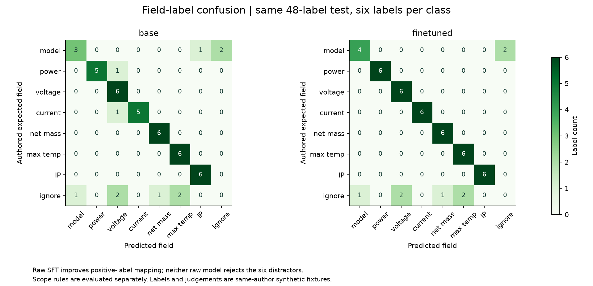
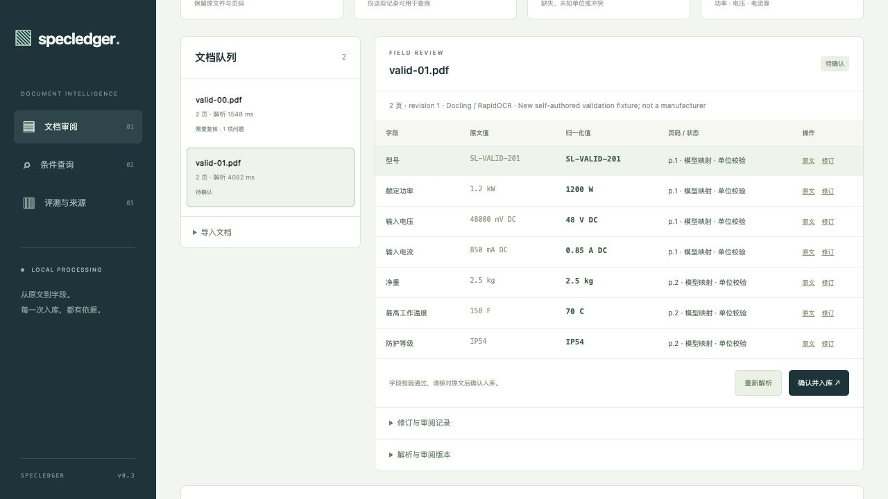
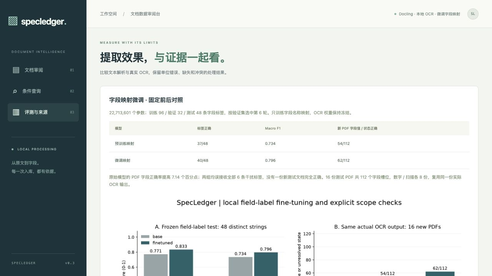
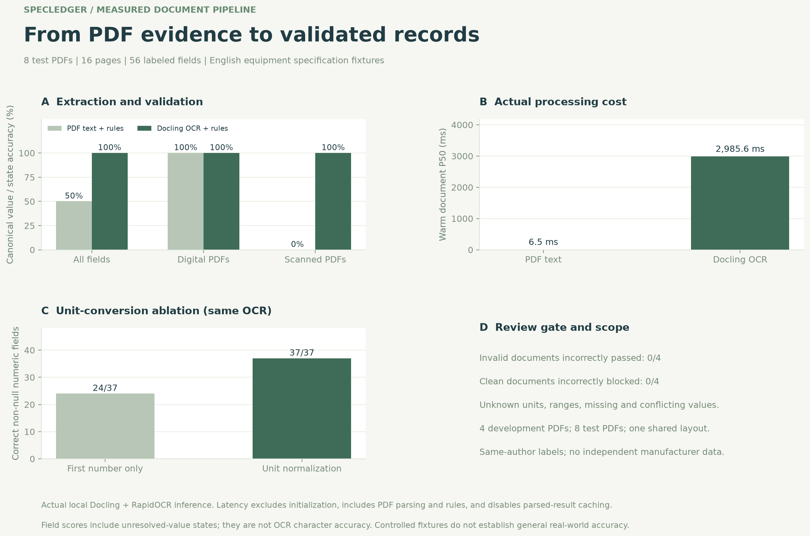

# SpecLedger · Document-to-Database Assistant · v0.3

[](https://github.com/xvbohan92-ai/specledger-document-assistant/actions/workflows/tests.yml)

A local equipment-specification PDF review system with Docling OCR, fine-tuned MiniLM field mapping, precise unit validation, source-page evidence, and transactional approval into SQLite. Includes frozen before/after evaluation, reproducible training, failure analysis, and source-backed charts.

设备规格 PDF → Docling / OCR → 7 类字段 → 单位归一化与校验 → 人工审阅 → SQLite 入库 → 带页码来源的条件查询。

实际运行了 **Docling 2.142.1、RapidOCR 3.10.0 与本地公开模型**；字段映射组件做了真实权重微调，OCR 和文档布局模型保持冻结。全部训练和本次评测使用本地推理，没有调用收费 API。

**v0.3 已实际完成字段名称映射模型的微调和对照评测。** 使用 22.7M 参数 MiniLM CrossEncoder，在 96／32／48 条构造标签上训练、验证和测试，仅用验证集选中第 6 轮；新建 24 份多版式 PDF、48 页。48 条标签测试正确数由 **37 → 40**，Macro F1 **0.734 → 0.796**；固定同一份真实 OCR 输出的 16 份新测试 PDF 上，字段值／状态正确数由 **54/112 → 62/112（+7.14 个百分点）**。

| 固定前后对照 | 同一预训练基座 | 微调检查点 |
| --- | ---: | ---: |
| 标签正确率 | 37/48（77.08%） | 40/48（83.33%） |
| 标签 Macro F1 | 0.733935 | 0.795579 |
| PDF 字段值／状态正确率 | 54/112（48.21%） | 62/112（55.36%） |
| 原始模型干扰标签错误接收 | 6/6 | 6/6 |

两组原始模型均误接收全部 6 条测试干扰标签，原始流程没有一份新测试 PDF 完全正确。失败分析后加入独立的字段范围检查，在复用测试集上的**事后工程诊断**为 **89/112 → 104/112**；该结果不能写成独立留出测试或纯微调收益，仍有 **6/12 份正常文档**需要复核。OCR 权重和单位计算保持原样，任何正式入库仍须人工批准。

[完整训练与复现说明](training/README.md) · [原始前后对照](reports/finetuning-evaluation.json) · [单列的范围检查诊断](reports/finetuning-scope-diagnostics.json) · [失败分析](reports/finetuning-analysis.json) · [逐文档 CSV](docs/figures/field-finetuning-documents.csv) · [训练记录](reports/finetuning-training.json)





所有新标签和 PDF 均为本项目构造，字段名称字符串在 train／valid／test 间无重复，但共享词汇、schema 和作者；不是独立真实厂商文档基准。新测试刻意使用旧别名表未覆盖的标签，旧版规则在其中仅有 1/112 个状态正确；因此微调收益以同一预训练模型为主要参照。旧版 8 份简单模板 PDF 仍单独保持 56/56，不能与这批新题混合。

## 系统演示

微调字段映射与单位校验保留原值和页码；通过检查的文档仍须人工确认。下图来自独立演示数据库，两份验证文档均未批准。





## 启动

需要 Python 3.11+、[uv](https://docs.astral.sh/uv/)；本机使用 Python 3.12。首次安装依赖和准备模型需要网络，正常解析使用本地模型。

```bash
uv sync --frozen --group docling --group viz
uv run specledger demo
uv run --group docling specledger prepare-models
uv run --group docling specledger demo --ingest
uv run --group docling specledger serve --port 8767
```

打开 [本地应用](http://127.0.0.1:8767/)。四份开发示例被解析到待审区，不会自动批准入库。先核查字段与原文，再点“确认并入库”，即可在“条件查询”使用记录。

纯文本基线可显式启动：`SPECLEDGER_BACKEND=text uv run specledger serve --port 8767`。它不执行 OCR，无法读取纯扫描件；界面和文档元数据都会标明实际后端。缺失模型时正常模式明确报错，不会偷偷降级成文本模式。

可用 `SPECLEDGER_DATA=/absolute/path` 指定另一个数据目录，避免混用已有文档。启动不会清空或覆盖现有数据库。

## 处理与审阅

- **7 类设备字段**：型号、额定功率、输入电压、输入电流、净重、最高工作温度、防护等级。限定英文标签及显式别名，不是任意文档通用抽取。
- **单位归一化**：W/kW/mW/MW、V/kV/mV、A/mA、kg/g/lb、C/F；区分单位大小写。使用 Decimal 换算并保留十进制精确值，电压和电流保留 AC/DC 属性。不猜测缺失单位，不把范围取平均，不把 N/A 填为零。
- **来源保留**：每条原始候选保留原值、原文、页码与归一化坐标。位置可能为行、单元格或整张表；界面明确标注。原始 PDF、解析缓存和模型有指纹约束。
- **入库准入**：缺失、未知单位、超出支持范围或多处数值冲突进入复核状态。校验通过也需要人工确认后才能进入查询表。
- **人工修订**：必须提供值、单位、核查页码与理由；修订明确标为人工输入，原始候选保留，不伪装成 OCR 识别值。版本号防止旧页面覆盖新修订，审批前与提交前都验证原文；正式记录、审阅状态、审计与版本快照在同一事务中完成。
- **条件查询**：只读取已批准记录，支持最多 5 个参数化条件，返回字段来源、页码、人工修订标记与实际 SQL。首版不使用 LLM 生成答案，也未实现开放式自然语言问答。
- **输入边界**：PDF 最大 32MB、20 页；拒绝不可读或加密文件、超大页面。暂不支持 Docling 合并后的跨页表格，避免将同一行错误绑定到多个页码。
- **重复与完整性**：相同字节只导入一次；原文件被修改或删除后，不再展示或查询其证据。校验失败不产生正式记录，原始上传文件不被移动。

```bash
uv run --group docling specledger ingest /absolute/path/specification.pdf \
  --source '素材来源、文档版本和使用说明'
```

上传和 CLI 导入使用同一套解析与校验逻辑。来源说明由上传者提供，系统不自动验证其真实性。所有字段均为演示设备规格，不用于真实设备安全认证。

## 实际评测

本节保留 v0.2 历史 OCR 基线。新增 v0.3 字段映射模型的前后对照见上方独立报告。

```bash
uv run --group docling specledger evaluate --split test
uv run --group viz specledger visualize
uv run pytest -q --junitxml=reports/test-results.xml
uv run ruff check specledger tests
node --test tests/value-format.test.mjs
```

固定素材共 **12 份自制英文 PDF、24 页**：4 份 dev、8 份 test，各划分内数字 PDF 和扫描 PDF 数量相同。扫描文件由页面图像构成，单元测试确认其没有隐藏文字层；其中一份测试扫描件加入轻微旋转与对比度降低。所有文档使用同一套简单模板，标注也由同一作者完成，不是独立真实厂商文档基准。

测试集为 **8 份 PDF、16 页、56 个字段值或未解决状态**。v0.2 本机实测：

| 指标 | pdfplumber 文本 + 校验 | Docling / RapidOCR + 校验 |
| --- | ---: | ---: |
| 字段值 / 状态正确 | 28/56 | 56/56 |
| 数字 PDF 字段正确率 | 100% | 100% |
| 纯扫描 PDF 字段正确率 | 0% | 100% |
| 预期来源页码召回 | 50% | 100% |
| 含问题文档错误放行 | 0/4 | 0/4 |
| 正常文档误拦 | 2/4 | 0/4 |
| 每份文档预热 P50 | 6.52 ms | 2985.56 ms |

含问题文档覆盖未知单位、数值范围、缺失值与跨页内容冲突。文本基线将扫描件的字段全部视为未提取到，因此“不放行错误文档”不代表它理解了扫描内容；正常扫描件也会被阻止。OCR 的额外成本与效果一起保留。

同一 Docling 输出上的单位消融：刻意只取第一个数字、不进行单位换算的基线正确 **24/37** 个非空数值字段，归一化后正确 **37/37**。这是规则消融，不是另一种 OCR 模型，也不是训练带来的提升。

指标口径：字段正确率同时检查规范值和预期的未解决状态，例如冲突值不能算成任意一个候选数值；它不是字符级 OCR 准确率。来源指标只核查页码，不衡量高亮框位置精度。延迟关闭解析结果缓存、排除模型初始化，包含 PDF 解析与字段规则。本机小样本单次计时，不是线上 SLA。界面队列里的缓存读取耗时会单独标注，不能当作 OCR 推理耗时。



完整记录：`reports/evaluation.json`；图表源数据：`docs/figures/source-values.json`；逐文档 CSV：`docs/figures/per-document.csv`。PDF 内容和标注指纹变化后会拒绝旧评测，不通过更换指纹来沿用旧成绩。评测不读取或改写已导入的业务数据库，不包含人工修订后的值。

## 验证与代码

当前 77 项 Python 工程测试及 2 项前端精度回归测试通过。保留旧版 52 项事务、审批、重新解析、单位精度与来源保护测试；新增字段映射值与来源绑定、模型文件校验、候选边界、范围检查、冻结数据和指标独立重算。单元测试使用文本后端和注入的有限映射器；真实模型训练及 OCR 对照另有记录。前端语法、页面和打包单独核查，远程 CI 尚未运行。

| 文件 | 职责 |
| --- | --- |
| `parsing.py` | 模型准备、指纹、PDF 解析、OCR、位置与缓存 |
| `fields.py` | 显式字段映射、单位换算、状态校验 |
| `store.py` | 待审区、正式表、事务、版本与审计 |
| `api.py` | 上传、页面预览、修订、批准与条件查询 |
| `demo.py` / `fixtures/cases.json` | 可再生 PDF、独立于抽取代码的人工指定标签 |
| `evaluation.py` / `visualize.py` | 冻结评测与来源可追溯的量化图表 |

## 开源来源与项目贡献

解析依赖 [Docling](https://github.com/docling-project/docling) 及其 [本地模型配置](https://github.com/docling-project/docling/blob/main/docs/usage/advanced_options.md)，OCR 由 [RapidOCR](https://github.com/RapidAI/RapidOCR) 执行。Docling 代码采用 MIT 许可证，各个模型使用其自身许可证。模型权重不打包或提交；`data/models/manifest.json` 保存实际模型 revision、软件版本与文件 SHA256。

本项目新增的是设备字段 schema、量纲处理、问题文档隔离、人工审阅与事务入库、页码与坐标追溯、完整性检查、界面和评测；不是提出新的 OCR 或文档布局算法。

v0.3 增加的是基于公开 MiniLM CrossEncoder 的八候选字段语义映射训练，保留原始单 logit 头，以八个固定字段说明的 softmax 交叉熵更新权重。个人贡献集中在 schema 和干扰标签设计、冻结对照、原文值绑定、范围检查、失败保留及审阅系统集成；不声称新的训练算法。模型来源：[MiniLM CrossEncoder](https://huggingface.co/cross-encoder/ms-marco-MiniLM-L6-v2)，其 Apache-2.0 许可独立于 Docling 及其他模型许可。

可准确用于简历的表述：

> 为设备规格文档审阅系统微调 22.7M 参数 MiniLM 字段映射组件，构建 96／32／48 条字段标签和 24 份多版式数字／扫描 PDF；在相同 OCR 输出的 16 份构造测试文档上，字段值／状态正确数由 54/112 提升至 62/112（+7.14 个百分点），补充独立范围检查与失败诊断，并集成原文页码追溯、单位校验及人工审批，通过 77 项 Python 和 2 项前端测试。

必须保留自制小样例的范围。真实厂商数据、独立标注、复杂跨页表格和中文效果尚未验证；不能将此结果写成通用 OCR 准确率或真实业务规模。


## v0.2：审批事务、重新解析和单位语义修复

### 审批与修订原子性

修复了“原文变化时接口报错，但审批或修订已提交”的问题。现在在写入前核查文件 SHA256，所有更新、审计和历史快照都在同一事务内执行；构造返回结果时再核对原文，失败会回滚。无效原文、过期版本、快照写入失败均不会留下部分批准、修订或正式记录。

### 同一 PDF 重新解析

文件去重仍按 SHA256 进行；界面“重新解析”和下列 CLI 会强制使用当前后端重新提取，不复用解析缓存：

```bash
uv run --group docling specledger reparse DOCUMENT_ID --revision CURRENT_REVISION \
  --reason '切换到 OCR 后重新提取扫描件'
```

- 成功后生成新的待审版本；旧提取值、人工修订、审批状态和审计保留在只读历史中。
- 新结果需要重新审阅。重新解析期间现有记录保持原状，成功提交后旧版本从当前查询中撤下；新版本再次批准后才恢复查询。
- 解析失败、原文变化或有人在解析期间修订，会保留原有版本和有效批准。过期版本不能覆盖较新的人工修改。
- 人工修订不自动覆盖新的 OCR 结果；历史仍可核查这些修订。界面提供“解析与审阅版本”及只读快照查看。
- API：`POST /api/documents/{id}/reparse` 接收 `revision` 和 `reason`；`GET /api/documents/{id}/versions/{revision}` 读取历史。

本机实际联调：同一份纯扫描 PDF 先用文本基线导入，得到 0 个字段；换为真实 Docling 后重新解析，得到 7 个字段，原来的空结果仍可在 r1 查看。

### 单位语义与精度

- `1 kg DC`、`60 C AC` 等不相容后缀明确拒绝。AC/DC 只适用于输入电压与输入电流。
- `24 V AC` 与 `24 V DC` 保留不同 `signal` 属性；同数值但属性冲突会进入复核。查询写明 AC/DC 时只匹配对应类型，不写时不限定类型。
- 移除六位小数强制舍入；`0.0001 g` 正确保留为 `0.0000001 kg`，前端显示也不会变成零。
- `exact_value` 保存规范值的高精度十进制文本；SQLite 数值条件用 Decimal 比较这些文本，避免 REAL 在极近边界处错误等同。普通数值列保留用于兼容与展示，不作为精确条件的最终依据。

### 旧数据库升级

首次启动 v0.2 会在一个事务内补充版本表和单位属性列，并为原有当前状态建立快照，再按新规则核验。原有批准若数值和语义均未改变则保留；受到新规则影响的批准退回待审，旧批准状态留在历史。更早的中间结果在 v0.1 中未保存完整快照，不能追溯重建。

本机升级前备份位于 `data/backups/ledger-before-v0.2.sqlite`，不打包或提交。迁移测试覆盖真实 v0.1 表结构、审批保留/失效分支及重复启动不重复迁移。

测试包括 17 项新增 Python 回归与 2 项前端回归，总计 52 项 Python 测试和 2 项前端测试。固定 8 份测试 PDF 的质量评测另外重新运行，结果及本次耗时以保存报告和图表为准；新增边界测试不会混入原有 56 个字段分母。真实厂商数据和多模板评测仍是后续工作。
